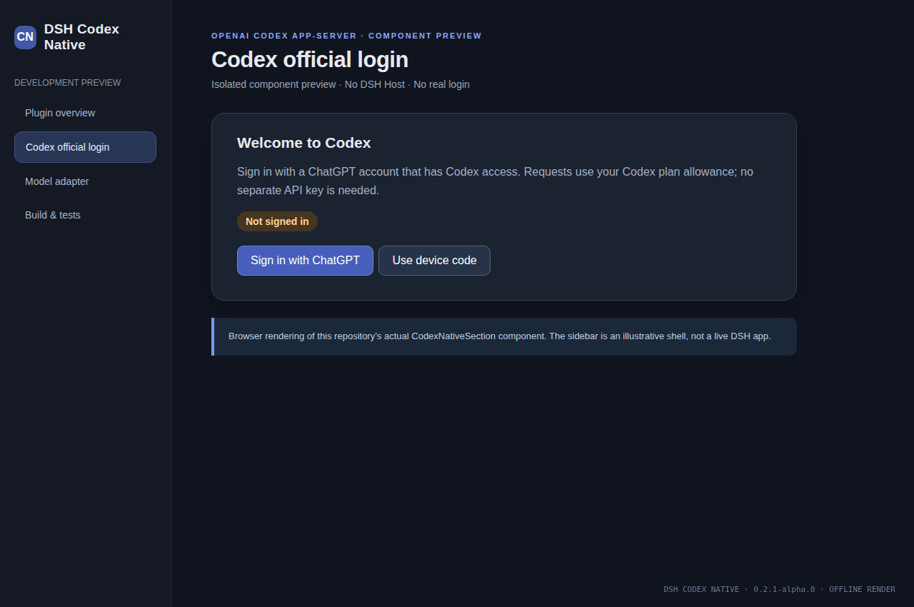

# DSH Codex Native

基于 **OpenAI 官方 Codex app-server** 的 DeepSeek Harness 主模型插件。社区项目，非 OpenAI 或 DeepSeek 官方产品。

**当前测试版：v0.2.1-alpha.4，适配 DSH 0.2.1-rc.2。** 修复新回复里的“未知内容块”和 Windows 启动链二次弹控制台问题。Windows/Linux 回归通过；真实订阅模型调用、Electron 桌面窗口可见性和原生交互审批不等同于已完整实机验收。

[English](README.md) · [复现与修复说明](docs/REPRODUCTION.md) · [验收状态](docs/STATUS.md) · [清理审计](docs/AUDIT.md)

## 官方桌面应用：GitHub 安装

在 DSH 侧栏选择 **插件 → 添加插件**，粘贴：

```text
github:Tests4gptplay/dsh-codex-native#v0.2.1-alpha.4
```

安装并启用后，**完全退出并重新启动 DSH**。进入 **设置 → Codex 官方登录**，用具有 Codex 使用权限的 ChatGPT 账号登录。然后在聊天模型选择器中选择 **codex-local / Codex (local login)**。

不需要 npm 账号或单独的 OpenAI API Key。调用使用账号适用的 Codex 计划额度，不是无限免费调用，也不是普通 Chat 模式消息用量。插件与官方 Codex 运行时仍需本地安装空间，但不需要维护源码开发目录或编译 TypeScript。

[GitHub Release](https://github.com/Tests4gptplay/dsh-codex-native/releases/tag/v0.2.1-alpha.4) · [备用预编译 TGZ](https://github.com/Tests4gptplay/dsh-codex-native/releases/download/v0.2.1-alpha.4/dsh-codex-native-0.2.1-alpha.4.tgz)

### Web CLI

```bash
dsh plugin --profile web add 'github:Tests4gptplay/dsh-codex-native#v0.2.1-alpha.4'
```

`web` 与桌面 `desktop` 是不同 profile；Web 安装不会自动装到桌面版。请使用固定版本标签，不要用开发分支 `main` 代替精简发行物。

## alpha.4 修复了什么

**未知内容块：** 旧版本移除了专用 UI，却继续输出 `codex-action` 自定义内容。官方 DSH 无对应显示分支，于是展示原始 JSON。这是插件前后端契约不一致。现在在输出进入 DSH 前，去掉聊天中的线程元数据和空诊断，原生命令/文件等必要操作提示转成标准文本；正常回复、推理、DSH 工具调用、错误和会话重放状态保留。

**Windows 控制台：** 官方固定版本的 JS 包装器会再次启动 `codex.exe`，这一层没有隐藏窗口参数。插件改为仅在自己的 Windows 登录/模型进程上，由 DSH 直接启动官方包内的原生二进制，保留 DSH 的进程归属、管道和取消机制。没有全局修改 DSH、没有关闭任意窗口或启动额外守护程序。

**历史消息不会被修改。** 已保存在旧聊天里的 `codex-action` 可能仍显示未知内容；修复作用于升级重启后的新回复。不要为此删除整个聊天数据库。

## 如何验证

[跨平台回归 CI](https://github.com/Tests4gptplay/dsh-codex-native/actions/runs/39947758087) 使用固定版本官方 DSH 源码 `687f282e8625c6b8d11ff58211a90524be2e4317`。Linux 126 项通过，Windows 专属测试在 Linux 跳过；Windows 127 项通过。

新增覆盖：真实本地子进程的模拟 Codex JSON-RPC、你报告的 `thread/start` 与 `turn/moderationMetadata`、官方 `AssistantMarkdown` 对“未知内容块”的渲染分支、工具/推理/回复/错误及重放状态保持、Windows 官方二进制无账号初始化。

这些测试在临时 CI 中运行。**发行标签只含 25 个运行文件，不含模拟后端、测试、源码、CI、开发依赖或安装脚本。** [发布及 GitHub 安装验证](https://github.com/Tests4gptplay/dsh-codex-native/actions/runs/39948312538)。

## 已知边界

- 账号实际支持的模型由 Codex 服务决定。菜单中的静态模型目录不保证每个模型都对当前账号开放。
- `openai-codex` 属于不同的 provider 标识；本插件默认注册的是 `codex-local`。切换或卸载其他模型插件后，旧会话配置可能仍指向旧 provider。
- Windows 已通过官方二进制真实启动与未登录账户读取，但云端 CI 不等于用户 Electron 桌面的可见窗口测试。
- 原生 Codex 的部分审批/信息征集尚未完整映射到 DSH 交互 UI；DSH 自己的动态工具仍走原有工具链。不要把此 Alpha 当作完整原生 Codex 客户端替代品。
- 不借用用户凭据做测试，不绕过 Codex 登录，不提供假登录或隐藏费用行为。

## 自有界面预览



这是此前从本项目真实 React 登录组件生成的隔离预览，非真实账号或 Electron 实机截图。见 [截图来源](docs/SCREENSHOTS.md)。

## 来源与许可

基于 [wss534857356/dsh-plugin-codex](https://github.com/wss534857356/dsh-plugin-codex) 的 MIT 实现，原始基线 `f1f61886f4defcf7294d63c3641fba01ee554e7b`。保留 LICENSE。官方运行时为 `@openai/codex@0.154.0`；框架是 DeepSeek Harness。使用官方运行时不表示此社区插件得到官方背书。
