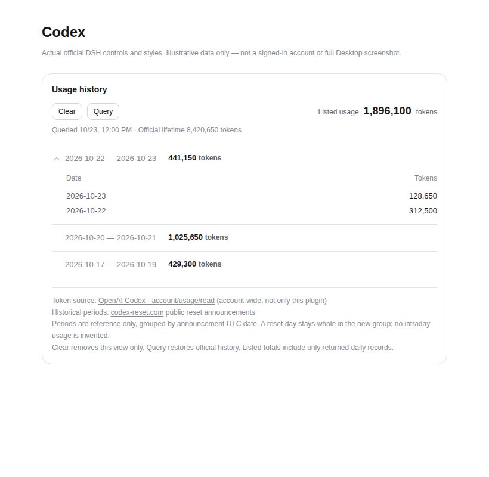

# DSH Codex Native

**使用 OpenAI 官方 Codex app-server 的 DeepSeek Harness 主模型插件** · 独立社区项目 · MIT

[English](README.md) · [发布状态](docs/STATUS.md) · [用量规则](docs/USAGE.md) · [本次交付核验](docs/DELIVERY-alpha5.md)

## alpha.6 协议断流修复

修复本地标准输入输出断开后请求挂起、退出详情丢失及失效缓存连接复用；下一次请求可从已有记录重建连接。不新增心跳、Watchdog、轮询或执行途中自动重放。尚未从用户机器日志确定最初退出原因，不宣称解决所有 Codex 崩溃。[复现与验证范围](docs/PROTOCOL_STREAM_FIX.md)。

## 当前测试版：v0.2.1-alpha.6

2026-10-23：历史用量查询与原生设置 UI 已完成，并已提供固定版本安装标签。适配 **DSH 0.2.1-rc.2**，使用官方 **Codex 0.154.0**。云端回归和安装检查已通过，但没有使用用户真实账号验证返回的历史范围，也未声称所有 Electron 桌面皮肤均已实测。

### 官方桌面应用（GitHub 安装）

在 DSH 桌面应用选择 **插件 → 添加插件**，粘贴：

```text
github:Tests4gptplay/dsh-codex-native#v0.2.1-alpha.6
```

安装后启用插件，完全退出并重新打开 DSH。打开 **设置 → Codex 官方登录**，使用具有 Codex 权限的 ChatGPT 账号登录；主聊天模型选择器使用 `codex-local`，不是其他插件的 `openai-codex`。

无需 npm 账号、单独的 OpenAI API Key、本地源码项目或 TypeScript 编译。不要为本插件修改 `allowBuilds`。请使用固定标签，**不要安装开发分支或 `main`**。

### Web CLI

```bash
dsh plugin --profile web add 'github:Tests4gptplay/dsh-codex-native#v0.2.1-alpha.6'
```

`web` 与桌面 `desktop` 是不同 profile；安装位置不自动互通。

[GitHub Release](https://github.com/Tests4gptplay/dsh-codex-native/releases/tag/v0.2.1-alpha.6) · [预编译 TGZ](https://github.com/Tests4gptplay/dsh-codex-native/releases/download/v0.2.1-alpha.6/dsh-codex-native-0.2.1-alpha.6.tgz)

## 历史用量：手动查询，不后台计量

进入设置页后，**只有点击“查询”才读取历史用量**。顶部同一行保留唯一的“清除”“查询”与当前列表总量。周期折叠行显示合计，展开显示每日 token；登录区和统计区使用 DSH 官方 `Button`、`DisclosureRow` 与 `--dsw-*` 主题变量，不捆绑第二份控件样式。

- **用量来源：** OpenAI Codex `account/usage/read`，是账号口径，不是仅本插件消耗。顶部列表总计汇总返回的每日记录；官方终身累计另标，二者可能不同。未知字段不当零。
- **周期来源：** 官方 `account/rateLimits/read` 只提供当前窗口及下次重置，不是完整历史流水。历史分组参考 [codex-reset.com](https://codex-reset.com/) 公共公告，按 UTC 日期整桶归组，**仅供参考，不保证等于个人账号实际周期，不捏造日内拆分**。
- **清除：** 只清空本页结果和合计；不删除 OpenAI 历史、不清聊天、不退出登录、不使用重置券。再次查询会取得官方历史。

上述来源、参考限制和清除说明也放在统计表格下。没有用量轮询、聊天统计钩子或额外模型调用。第三方只接收独立的公共 GET，不接收邮箱、账号、token、提示词或个人用量；参考服务失败不丢弃已取得的官方用量，也不阻断 Agent。

## 用户实机确认（2026-10-23）

用户已确认 alpha.5 的手动历史查询成功，以下为其 DSH 桌面与当前皮肤下的实际截图，经用户确认后公开。


*账号行已替换为 `GPT-Codex@OpenAI.com`（虚构展示文字，不代表真实 OpenAI 账号）。除账号区域外，原图尺寸、界面、日期和用量数字均未改动；这不是 AI 重绘的界面。周期分组仍仅供参考，不能据此认定个人账号的准确重置时刻。*

这是该用户当前环境的一次成功确认，不代表所有账号、皮肤或原生工具均已完成验收。其他开发期浅色/深色示例保留在下方，来源另行标明。



*本插件实际组件与官方控件的浅色示例预览，不是真实账号截图。* [深色示例](docs/screenshots/codex-usage-dark.png) · [截图来源](docs/SCREENSHOTS.md)

## 已核验与边界

[跨平台回归](https://github.com/Tests4gptplay/dsh-codex-native/actions/runs/39959031468)、[分支重复验证](https://github.com/Tests4gptplay/dsh-codex-native/actions/runs/39961943894)、[发布与精确 GitHub 安装](https://github.com/Tests4gptplay/dsh-codex-native/actions/runs/39959807125) 已通过。已下载分支构建，确认两个 JS 运行文件与 alpha.5 标签的 Git blob 完全一致。

安装标签仅有运行文件、声明、配置、许可证和 README；没有 `src/`、`tests/`、mock、截图、CI、构建脚本或开发依赖。依赖和官方 Codex 运行时本身仍占安装空间。开发仓库中的测试用于云端验证，不会随安装运行。

真实账号用量是否可用、返回范围与延迟由官方服务决定。完整原生 Codex 审批桥接是此前已有局限，本次统计 UI 不改变它。旧历史中的 `codex-action` 不被改写；alpha.4 的新回复显示与 Windows 直接启动修复予以保留。

## 许可与来源

基于 MIT 项目 [wss534857356/dsh-plugin-codex](https://github.com/wss534857356/dsh-plugin-codex)，原始导入提交 `f1f61886f4defcf7294d63c3641fba01ee554e7b`，保留原 LICENSE。框架来自 DeepSeek，Codex 引擎来自 OpenAI；本插件不是两者的官方产品。公共重置数据署名 **Data: codex-reset.com**，遵循其公开接口和署名要求。
