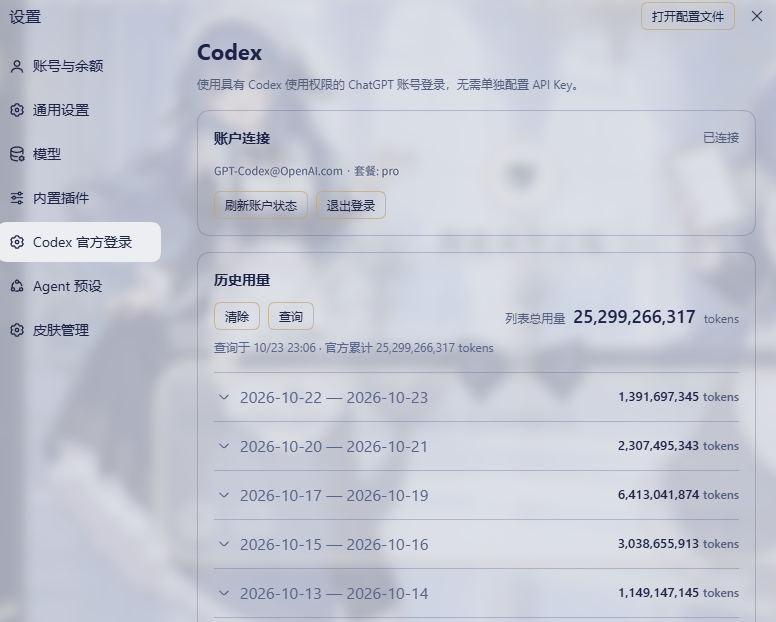

# DSH Codex Native

**使用 OpenAI 官方 Codex app-server 的 DeepSeek Harness 主模型插件** · 独立社区项目 · MIT

[English](README.md) · [发布状态与证据](docs/STATUS.md) · [用量规则](docs/USAGE.md) · [协议修复说明](docs/PROTOCOL_STREAM_FIX.md) · [账号生命周期审计](docs/ACCOUNT_LIFECYCLE_AUDIT.md)

开发中：[上下文计量与 Codex 自动压缩接管修复](docs/CONTEXT_COMPACTION_AUDIT.md)。此修复尚未发布，需要配套宿主改动；下方正式安装版本仍为 alpha.7。

## 当前测试版：v0.2.1-alpha.7

2026-10-24（日本时间）：先在 Windows/Linux 隔离环境复现，再修复两类账号生命周期缺陷；保留 alpha.6 的协议断流修复。适配 **DSH 0.2.1-rc.2**，使用官方 **Codex 0.154.0**。尚未确定用户最初进程退出的原因，不能只凭此前的断流提示判断 OpenAI 云端宕机。

### 官方桌面应用安装

打开 **插件 → 添加插件**，粘贴：

```text
github:Tests4gptplay/dsh-codex-native#v0.2.1-alpha.7
```

启用后完全退出并重新打开 DSH。通过 **设置 → Codex 官方登录** 使用具有 Codex 权限的 ChatGPT 账号，主聊天模型选择 `codex-local`；其他插件的 `openai-codex` 不是本插件的提供方。

不需要 npm 账号、单独的 API Key、本地源码项目、TypeScript 编译或 `allowBuilds` 例外。请使用固定标签，不要安装 `main` 或开发分支。本次修复不会删除已有登录文件。

```bash
dsh plugin --profile web add 'github:Tests4gptplay/dsh-codex-native#v0.2.1-alpha.7'
```

Web 与 Desktop 是不同 profile。 [Release](https://github.com/Tests4gptplay/dsh-codex-native/releases/tag/v0.2.1-alpha.7) · [预编译 TGZ](https://github.com/Tests4gptplay/dsh-codex-native/releases/download/v0.2.1-alpha.7/dsh-codex-native-0.2.1-alpha.7.tgz)

## alpha.7：先复现，再修复

此前停用账号服务时，正在初始化或等待状态、额度、历史查询的账号子进程可能漏掉回收。现在从初始化之前开始记录归属，停用时回收本服务拥有的账号连接。明确取消登录时尽力发送协议取消请求，然后关闭该登录连接，不再无限等待确认，不影响模型任务进程或已保存的凭据。

原样八个新增用例及既有回归在两个平台均通过。生产源码只修改 `src/native-account.ts`；没有新增依赖、Watchdog、心跳、轮询、模型任务时限、审批策略或前端改动。原有六秒账号清理等待不变，只在关闭进程时生效。[前后对照与边界](docs/ACCOUNT_LIFECYCLE_AUDIT.md)。

## 保留的 alpha.6 修复

管道关闭后，正在等待写入缓冲区的请求会正确结束，不再无限等待。错误保留本地退出码、信号和有限长度的标准错误，遮盖常见凭据内容；清理阶段才观察到的退出会明确标注，不冒充最初原因。账号子进程启动失败即使没有输出事件也能被接收。

已经关闭的缓存线程在下一次请求时从已有历史重建，包含已记录的工具结果；不新增执行途中自动重放，不重新执行已有结果的工具。不增加心跳、Watchdog、重连轮询或模型任务硬时限，原有宿主重试与模型策略不变。

## 历史用量：手动查询，不后台计量

只有点击 **查询** 才获取历史。顶部仅有一个 **清除**、**查询** 和列表总计；周期收起仍显示合计，展开显示每日数据。使用 DSH 官方 `Button`、`DisclosureRow` 和 `--dsw-*` 主题变量。前端编译文件与 alpha.5 完全相同。

Token 来自官方 `account/usage/read`，是账号口径，不是仅本插件用量。列表总计汇总返回的每日记录，官方终身总量另外标明；未知值不当作零。

官方 `account/rateLimits/read` 提供当前窗口和下一次重置时间，不是完整历史流水。历史分组参考 **Data: codex-reset.com** 公共公告，按 UTC 日期整桶归组，仅供参考，不证明个人账号的准确边界，也不虚构日内拆分。公共请求不携带凭据、账号、提示词或用量，参考来源故障不阻断模型执行。

清除只清本页显示，不删除官方历史、聊天或登录文件，不消耗重置券；再次查询会恢复官方数据。来源与限制也直接写在表格下方。

## 用户实机确认（alpha.5）

用户已确认 alpha.5 手动查询在其 DSH Desktop 与当前皮肤中成功，并授权公开下图；这不是后续协议或账号修复已在用户机器验收的证明。



*仅账号行替换为 `GPT-Codex@OpenAI.com`，是虚构展示文字，不代表真实 OpenAI 账号。其他像素、日期和用量保持原样，不是 AI 重绘界面。*

[浅色示例](docs/screenshots/codex-usage-light.png) · [深色示例](docs/screenshots/codex-usage-dark.png) · [截图来源](docs/SCREENSHOTS.md)

## 验证与边界

[Linux/Windows 回归](https://github.com/Tests4gptplay/dsh-codex-native/actions/runs/40048042517)和[发布、精确 GitHub 安装](https://github.com/Tests4gptplay/dsh-codex-native/actions/runs/40048610503)均通过。下载的已测构建与发布标签的运行 JS 字节一致；新增故障测试使用真实子进程和官方 DSH 子进程运行时，仅 Codex 对端为可控测试替身；没有使用用户凭据或模型额度。缓存空闲阈值测试是加速边界测试，不是一小时真实模型耐久测试。

安装包只包含编译运行文件、声明、配置、许可证和说明；没有源码、测试、模拟后端、CI、截图、安装脚本或开发依赖。正常运行依赖仍占磁盘空间。此前原生 Codex 审批交互的局限保持说明；云端测试不等于所有桌面/皮肤组合或用户最初故障都已验证。[详细证据](docs/STATUS.md)。

## 许可与来源

基于 MIT 项目 [wss534857356/dsh-plugin-codex](https://github.com/wss534857356/dsh-plugin-codex)，导入基线 `f1f61886f4defcf7294d63c3641fba01ee554e7b`，保留原 LICENSE。框架来自 DeepSeek，Codex 引擎来自 OpenAI；本插件不是双方官方产品。公共重置数据署名 **codex-reset.com**。
